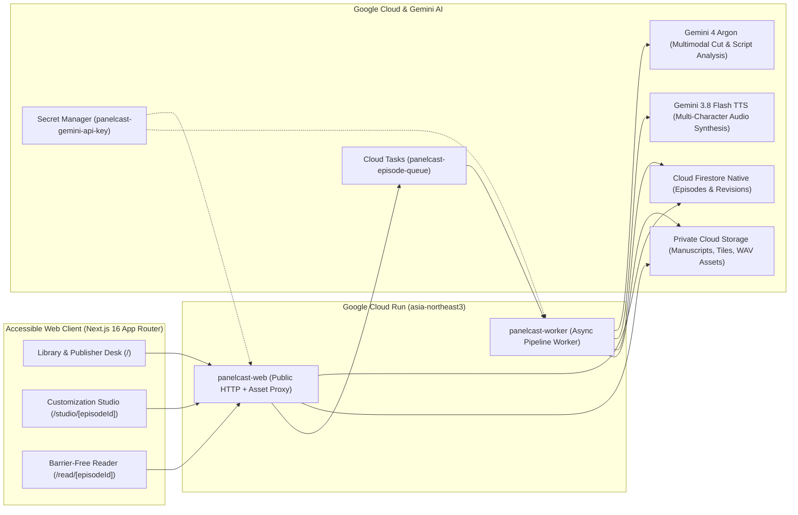

# PanelCast — Barrier-Free Webtoon Publishing & Audio Reader Platform

**PanelCast** transforms vertical-scroll webtoon manuscripts into barrier-free, multi-voice audio editions for blind and low-vision readers. Built with **Google Gemini (`gemini-4-argon` & `gemini-3.8-flash-tts`)** and **Google Cloud (`Cloud Run`, `Firestore`, `Cloud Storage`, `Cloud Tasks`, `Secret Manager`)**, PanelCast bridges the gap between webtoon creators on tight weekly deadlines and screen-reader users who need structured, spoiler-safe scene narration, expressive character voices, and verified sound effects.

- **Live Production Web App (`panelcast-web`)**: `https://panelcast-web-954098036508.asia-northeast3.run.app`
- **Live Accessible Reader (`ep_solo_max_newbie_02`)**: `https://panelcast-web-954098036508.asia-northeast3.run.app/read/ep_solo_max_newbie_02`
- **Live Customization Studio (`ep_solo_max_newbie_02`)**: `https://panelcast-web-954098036508.asia-northeast3.run.app/studio/ep_solo_max_newbie_02`
- **Private Worker Service (`panelcast-worker`)**: `https://panelcast-worker-954098036508.asia-northeast3.run.app`
- **GitHub Repository**: `https://github.com/froggy-hyun/PanelCast`

---

## Key Capabilities

### 1. Dual Publishing Workflows for Webtoon Creators & Publishers
- **Path A — Auto Publish (`바로 등록`)**: Designed for creators right after a weekly manuscript deadline. A single upload slices long vertical strip manuscripts into overlapping analysis tiles, extracts panel boundaries and reading order via `gemini-4-argon`, reconciles the episode cast, assigns distinct Korean and English voices, matches verified sound effects (with voice-narration fallback when confidence is low), validates 100% of audio assets, and atomically publishes the episode.
- **Path B — Accessibility Customization (`접근성 커스텀`)**: Opens the **Studio Workbench (`/studio/[episodeId]`)** where creators or accessibility editors can:
  - Cast voices per character from a 12-voice pool (`Kore`, `Puck`, `Charon`, `Fenrir`, `Aoede`, `Zephyr`, `Leda`, `Orus`, `Callirrhoe`, `Autonoe`, `Enceladus`, `Iapetus`) with custom acting style prompts, speaking rate, and pitch hints.
  - Configure **Spoiler-Safe Speaker Masking (`unrevealedLabel` & `revealedAtPanelId`)** so mysterious characters are announced as *"Unidentified Voice"* (`정체불명의 목소리`) until the exact panel where their identity is revealed.
  - Merge duplicate character detections (`Merge Characters`).
  - Adjust per-cut hold times (`extraHoldMs`), dialogue pauses (`pauseAfterMs`), and sound effect cues (`sound_effect` vs. `voice_narration` fallback).
  - Run **Selective Regeneration (`inputHash` guard)**: only modified dialogue or voice segments are re-synthesized while unchanged audio assets are reused and stale worker outputs are rejected.
  - Edit a cloned draft revision (`cloneRevisionAsEditableDraft`) while readers continue listening to the currently published revision uninterrupted.

### 2. Barrier-Free Reader (`/read/[episodeId]`)
- **Sequential Cut & Segment Playback**: Plays each cut's sound cues and dialogue/narration segments strictly in order, waiting for every segment `ended` event plus `extraHoldMs` before advancing to the next cut.
- **Full Keyboard & Screen-Reader Operability**:
  - `Space`: Play / Pause sequential cut playback
  - `→` or `J`: Next cut (immediately cancels prior audio/timers and announces the new cut via `aria-live="polite"`)
  - `←` or `K`: Previous cut
  - `R`: Replay current cut from the beginning
  - `L`: Switch playback language between **Korean (`ko`)** and **English (`en`)** while preserving the current cut position
  - **Input Focus Guard**: All single-key shortcuts automatically pause when typing in the reader feedback form.
- **High-Contrast Editorial UI**: Warm paper-and-ink publication aesthetic (`Noto Serif KR` + `Pretendard`) with a one-click **High Contrast (`data-contrast="high"`)** mode and 44×44px minimum touch targets. Passes `@axe-core/playwright` WCAG 2.1 AA audits with zero critical or serious violations.

---

## System Architecture



### Engineering Highlights
1. **Boundary-Preserving Overlap Tiling (`src/lib/tiling.ts`)**: Webtoon manuscripts are uploaded as 50–80 vertical strips (e.g., 60 strips × `690×1600px` = `96,000px` tall). PanelCast stitches and slices strips into overlapping vertical windows (`overlapPx = 400px`) so speech bubbles split across strip edges are never lost, then deduplicates overlapping detections via vertical IoU and normalized text similarity.
2. **Unlimited Cast Orchestration (`src/lib/cast.ts` & `src/lib/gemini.ts`)**: Instead of relying on a 2-speaker multi-speaker TTS call, PanelCast orchestrates individual per-segment single-voice synthesis calls across a 12-voice prebuilt pool and automatically differentiates overflow supporting characters via speaking rate, pitch, and style prompt modifiers.
3. **Private Manuscript & Audio Proxy (`src/app/api/assets/[...assetPath]/route.ts`)**: Raw webtoon manuscripts and generated audio are stored in a private GCS bucket (`publicAccessPrevention: enforced`). Public readers can stream only assets referenced by the currently `published` revision, while unpublished draft assets require an authenticated studio session.

---

## Featured Demo Episode

- **Title**: *Solo Max-Level Newbie — Ep. 02: Prologue* (`나 혼자 만렙 뉴비 — 02화. 서막`)
- **Episode ID**: `ep_solo_max_newbie_02` (`rev_ep_solo_max_newbie_02_v1`)
- **Source Manuscript**: 60 vertical JPEG strips (`01.jpg`–`60.jpg`, `690×1600px` each, `96,000px` total vertical height, `66.24 MP`, 25 overlapping vertical tiles)
- **Processed Output**: **42 narrative cuts/panels**, **104 dialogue & narration segments**, **19 distinct characters** with spoiler-safe speaker naming, **22 sound cues**, and **208 synthesized Korean (`ko`) + English (`en`) RIFF WAV audio tracks** (`status=published`, `valid=true`, `issues=0`).

---

## Local Development & Verification

### Prerequisites
- Node.js `>= 22.0.0`
- Google Cloud SDK (`gcloud`) authenticated against project `h2gdm-hack26icn-2669`

### 1. Install Dependencies
```bash
npm install
```

### 2. Configure Environment
Copy `.env.example` to `.env` and populate `GEMINI_API_KEY` and `PANELCAST_STUDIO_SECRET`:
```bash
cp .env.example .env
```

### 3. Run Unit & Pipeline Integration Suite (`T01`–`T18`)
```bash
npm test
```

### 4. Build & Start Production Server
```bash
npm run build
npm run start
```

### 5. Run Playwright E2E & Axe-Core WCAG 2.1 AA Suite
```bash
npm run test:e2e
```

---

## Google Cloud Run Deployment (`asia-northeast3`)

Both `panelcast-web` and `panelcast-worker` are deployed as container services in `asia-northeast3` (`Seoul`) with `GEMINI_API_KEY` mounted from Google Cloud Secret Manager (`panelcast-gemini-api-key`):

```bash
# Build container image with Cloud Build
gcloud builds submit --tag gcr.io/h2gdm-hack26icn-2669/panelcast:latest

# Deploy public web service
gcloud run deploy panelcast-web \
  --image gcr.io/h2gdm-hack26icn-2669/panelcast:latest \
  --region asia-northeast3 \
  --allow-unauthenticated \
  --set-env-vars="GCP_PROJECT_ID=h2gdm-hack26icn-2669,GCP_REGION=asia-northeast3,GCS_PRIVATE_BUCKET=h2gdm-hack26icn-2669-panelcast-private,CLOUD_TASKS_QUEUE=panelcast-episode-queue,ENABLE_CLOUD_STORAGE_SYNC=true,PANELCAST_SERVICE_MODE=web" \
  --set-secrets="GEMINI_API_KEY=panelcast-gemini-api-key:latest"

# Deploy private async worker service
gcloud run deploy panelcast-worker \
  --image gcr.io/h2gdm-hack26icn-2669/panelcast:latest \
  --region asia-northeast3 \
  --no-allow-unauthenticated \
  --set-env-vars="GCP_PROJECT_ID=h2gdm-hack26icn-2669,GCP_REGION=asia-northeast3,GCS_PRIVATE_BUCKET=h2gdm-hack26icn-2669-panelcast-private,CLOUD_TASKS_QUEUE=panelcast-episode-queue,ENABLE_CLOUD_STORAGE_SYNC=true,PANELCAST_SERVICE_MODE=worker" \
  --set-secrets="GEMINI_API_KEY=panelcast-gemini-api-key:latest"
```